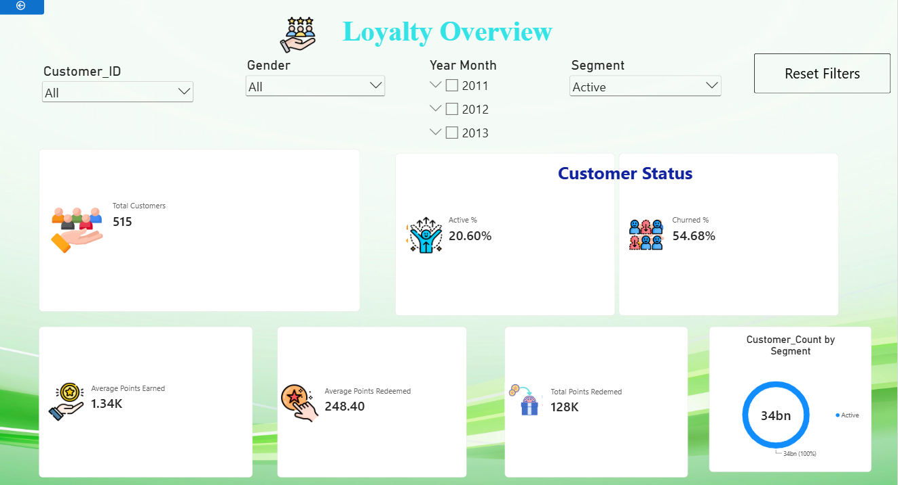
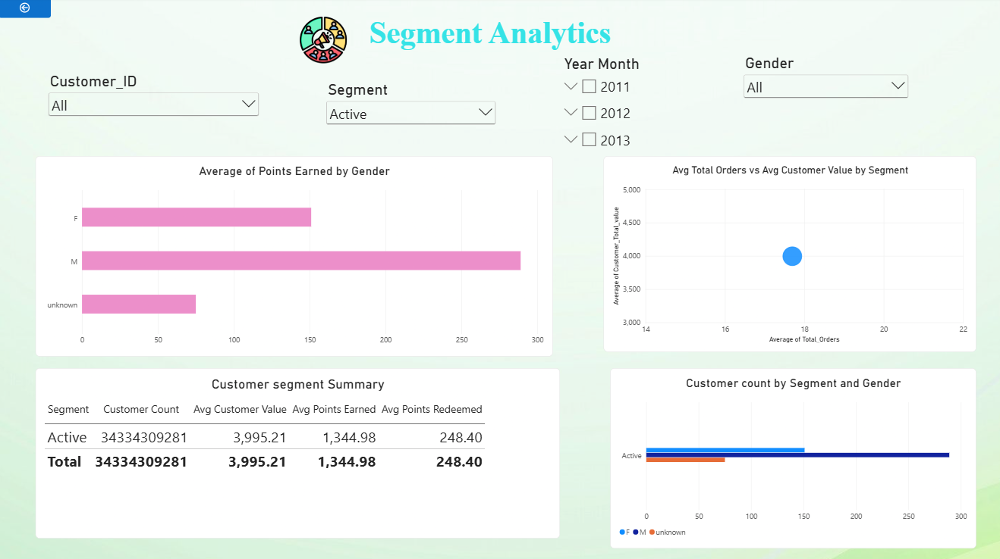
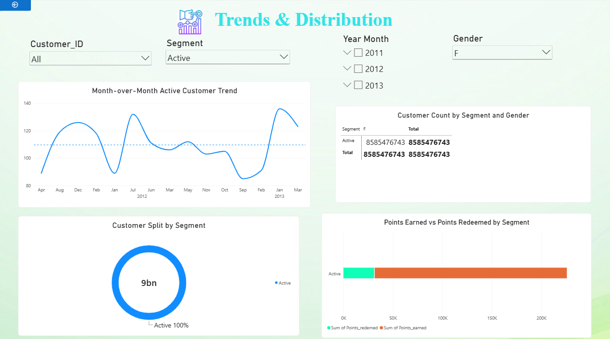

# Hypermarket Customer Loyalty, Retention & Segmentation

An end-to-end data analytics project using **MySQL and Power BI** to analyse customer loyalty, redemption behaviour, retention patterns and customer segmentation for a hypermarket business.

## Project Overview

This project explores customer engagement with a hypermarket's loyalty program. It uses SQL to answer business questions about loyalty points, customer activity, churn and segmentation, and Power BI to present the analysis through interactive dashboards.

## Business Objectives

- Analyse loyalty points earned and redeemed across customer groups.
- Identify active and churned customers.
- Evaluate customer engagement and purchase frequency.
- Rank customers based on loyalty participation.
- Track monthly active-customer trends.
- Segment customers based on recency and total customer value.
- Support customer retention and loyalty marketing decisions.

## Tools & Technologies

- **SQL:** MySQL
- **Data Visualization:** Microsoft Power BI
- **Data Modelling & Calculations:** DAX
- **Version Control:** Git and GitHub

## Dataset Description

The case study uses three relational tables:

| Table | Description |
|---|---|
| Customer | Customer demographics, transaction dates, total customer value, orders and loyalty points |
| Product | Product details, merchant locations, sub-categories and cost prices |
| Transactions | Order information, transaction dates, sales amounts, quantities and promotions |

**Dataset period:** January 2012 – March 2013, with a small number of records from December 2011.

## SQL Analysis

The SQL case study covers 10 business tasks:

1. Calculate average loyalty points earned by gender.
2. Identify customers with above-average points redeemed.
3. Calculate the percentage of customers classified as churned.
4. Rank customers by total loyalty points earned.
5. Calculate and rank average total orders by gender.
6. Measure month-over-month changes in active customers.
7. Identify the top customer by points redeemed for each merchant location.
8. Calculate a running total of monthly active customers.
9. Determine weekly transaction counts for the top five customers by points earned.
10. Analyse average total customer value across customer segments.

### SQL Concepts Applied

- Aggregate functions and `GROUP BY`
- Joins and subqueries
- Common Table Expressions (CTEs)
- `CASE` statements
- Window functions
- `RANK()` and `LAG()`
- Running totals
- Date and time functions
- Customer segmentation

## Power BI Dashboards

The Power BI report contains three dashboard pages:

### 1. Loyalty Overview

- Total customers
- Active and churned customer percentages
- Average points earned
- Average points redeemed
- Total points redeemed

### 2. Segment Analytics

- Average points earned by gender
- Average orders versus average customer value by segment
- Customer segment summary
- Customer count by segment and gender

### 3. Trends & Distribution

- Month-over-month active-customer trend
- Customer distribution by segment and gender
- Customer split across loyalty segments
- Points earned versus points redeemed by segment

### Interactivity

The case study includes requirements for slicers, drill-through, report tooltips and bookmarks.

## Dashboard Preview

### Loyalty Overview



### Segment Analytics



### Trends & Distribution



## Key Learning Outcomes

- Translating business requirements into SQL queries.
- Analysing customer loyalty and retention behaviour.
- Applying window functions and CTEs to analytical problems.
- Understanding customer segmentation and churn analysis.
- Building Power BI dashboards for business reporting.
- Presenting analytical information in a structured and understandable way.

## Project Files

- [SQL Case Study](sql/SQL%20Case%20Study.sql)
- [Power BI Dashboard](powerbi/Aashi_Hypermarket.pbix)

## Repository Structure

```text
hypermarket-customer-analytics/
│
├── README.md
│
├── sql/
│   └── SQL Case Study.sql
│
├── powerbi/
│   └── Aashi_Hypermarket.pbix
│
└── images/
    ├── loyalty-overview.png
    ├── segment-analytics.png
    └── trends-distribution.png
```

## Conclusion

This project demonstrates the application of SQL and Power BI to customer loyalty, retention and segmentation analysis. It combines query-based analysis with interactive business reporting to support data-driven customer engagement decisions.
